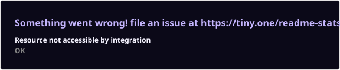

  

<h1 align="center">Hey there, I'm Ashutosh Dash 👋</h1>

<h3 align="center">
  
</h3>

  <em>Human-minded engineering. Thoughtful interfaces. Products that solve real problems.</em>

  
  
  
  

---

## 💜 About Me

I'm a **Frontend Engineer** who enjoys turning ideas into polished, useful digital products.

I care about the details that make software feel right: thoughtful interactions, accessible interfaces, maintainable code, and performance that doesn't get in the way.

- 💻 Focused on building modern frontend experiences.
- 🎨 Interested in UI engineering, interaction design, and product thinking.
- ⚡ Always exploring better ways to build for the web.
- 🚀 Motivated by solving real problems through technology.

---

## 🛠️ Tech Stack

  
   
  
   
  

---

## 🚀 Featured Projects

### 1. Shape Box Creator

A visual editor for creating custom UI shapes with CSS polygon clip paths.

- Create and adjust polygon points visually.
- Experiment with custom shapes.
- Export CSS or SVG for use in projects.

  

### 2. Rocket Lab

A playful rocket-building experience with a blueprint-inspired canvas.

- Customize rockets with different parts.
- Build and experiment with designs.
- Launch rockets and explore live telemetry.

  

### 3. Potato Mode

A Chrome extension that simulates slower devices to help explore frontend performance trade-offs.

- Simulate constrained device performance.
- Experience how interfaces behave under slower conditions.
- Understand the impact of performance on user experience.

  

### 4. UGC Agentic Lawyer — Frontend

An AI-powered legal assistant frontend focused on Indian laws, legal matters, and procedures.

- Designed to make legal information easier to explore.
- Built around an AI-assisted user experience.
- Focused on a clear and approachable interface.

  

---

## 📊 GitHub Activity

  
  

  

  

---

## 🤝 Let's Connect

  I'm always interested in connecting with people who enjoy building useful things for the web.

  
  
  

  <strong>Build thoughtfully. Keep learning. Make it useful. 💜</strong>

